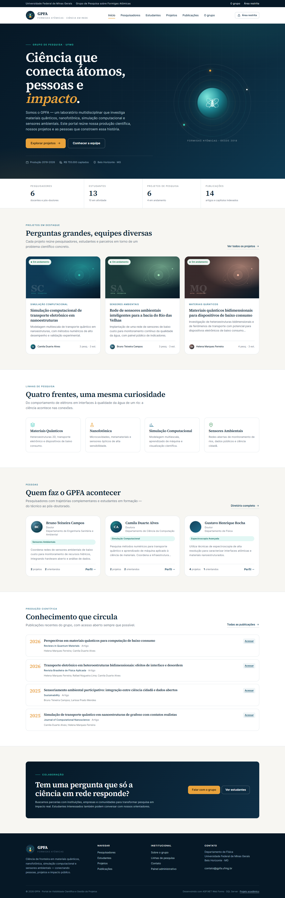
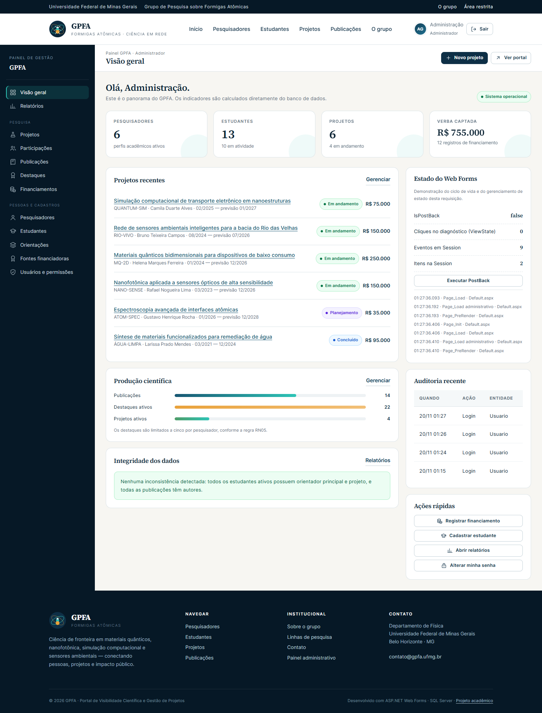

# GPFA — Portal de Visibilidade Científica e Gestão de Projetos

Portal institucional e sistema de gestão do **Grupo de Pesquisa sobre Formigas Atômicas (GPFA)**, desenvolvido como projeto final da disciplina de Programação Web.

O sistema reúne, em um único lugar, a vitrine pública da produção científica do grupo e o painel administrativo que garante a consistência dos vínculos acadêmicos: estudantes sempre ligados a projetos e orientadores, coordenação única por projeto, publicações com autoria e financiamentos contabilizados sem duplicidade.

> **Aviso:** nomes, projetos, publicações e valores deste repositório são **fictícios**, usados apenas para demonstração acadêmica.

---

## Sumário

- [Visão geral](#visão-geral)
- [Funcionalidades](#funcionalidades)
- [Tecnologias](#tecnologias)
- [Arquitetura](#arquitetura)
- [Regras de negócio em destaque](#regras-de-negócio-em-destaque)
- [Estrutura de pastas](#estrutura-de-pastas)
- [Como instalar e executar](#como-instalar-e-executar)
- [Banco de dados](#banco-de-dados)
- [Usuários de demonstração](#usuários-de-demonstração)
- [Testes](#testes)
- [Documentação](#documentação)
- [Equipe](#equipe)
- [Versionamento e colaboração](#versionamento-e-colaboração)

---

## Visão geral

O GPFA cresceu e suas informações estavam dispersas em planilhas, currículos desatualizados e páginas isoladas. O portal resolve três problemas centrais:

1. **Visibilidade pública** — qualquer visitante encontra pesquisadores, estudantes, projetos, publicações e resultados do grupo.
2. **Consistência acadêmica** — o sistema impede estudantes sem projeto/orientador, projetos sem coordenador único, publicações sem autores e destaques fora do limite de cinco.
3. **Transparência financeira** — cada financiamento é registrado por projeto e fonte, e os totais são calculados por consultas que não duplicam valores.

### Objetivo geral

Centralizar, organizar, gerenciar e divulgar as informações científicas e administrativas do GPFA por meio de um portal web em ASP.NET Web Forms, com banco relacional SQL Server e arquitetura em camadas.

### Objetivos específicos

- Cadastrar e divulgar pesquisadores, estudantes, orientadores e egressos.
- Gerenciar projetos com coordenação única e múltiplos participantes.
- Controlar orientações principais e coorientações, separando orientandos atuais e passados.
- Registrar publicações, autoria e os cinco destaques de cada pesquisador.
- Registrar fontes e valores de financiamento, calculando totais por projeto, fonte e pesquisador.
- Oferecer relatórios administrativos e um painel com indicadores reais do banco.
- Aplicar autenticação, autorização por perfil, validações e tratamento de erros.
- Demonstrar domínio de Master Pages, controles de servidor, Data Binding, ciclo de vida e Session.

---

## Funcionalidades

### Área pública

| Página | Recursos |
|---|---|
| **Início** | Identidade do grupo, indicadores, projetos em destaque, linhas de pesquisa, equipe e publicações recentes. |
| **Pesquisadores** | Diretório com busca por nome/área, cards com foto, formação, área e links Scholar/ORCID/Lattes. |
| **Perfil do pesquisador** | Biografia, formação, links, projetos, coordenações, **orientandos atuais**, **egressos**, todas as publicações e os **5 destaques**. |
| **Estudantes** | Diretório com nível, curso, situação, orientador principal, coorientadores, projetos e filtros. |
| **Projetos** | Portfólio filtrável por situação, linha e texto, com coordenador, período, equipe e verba captada. |
| **Detalhe do projeto** | Descrição, coordenação, participantes, estudantes, publicações associadas e financiamentos detalhados. |
| **Publicações** | Lista paginada com filtros por ano, pesquisador e projeto, autoria, DOI/link e acesso externo. |
| **O grupo** | História, missão, linhas de pesquisa, arquitetura do portal e contato institucional. |

### Painel administrativo

- Dashboard com indicadores, projetos recentes, alertas de integridade, auditoria e diagnóstico do ciclo de vida/Session.
- CRUD de pesquisadores, estudantes, orientações, projetos, participações, vínculos de estudantes, publicações, destaques, financiamentos, fontes financiadoras e usuários.
- Perfis **Administrador**, **Coordenador** e **Pesquisador**, com escopo de dados e menus adaptados.
- Relatórios de projetos por situação, financiamentos por projeto/fonte/pesquisador, publicações por ano/pesquisador, orientandos atuais/passados e alertas de integridade.
- Exclusões protegidas por chaves estrangeiras, triggers e mensagens amigáveis.
- Auditoria das ações administrativas.

---


## Capturas

| Portal público | Painel administrativo |
|---|---|
|  |  |

Mais telas em [`docs/images`](docs/images): perfil de pesquisador, projetos, publicações, relatórios, financiamentos e versões mobile.
## Tecnologias

| Camada | Tecnologia |
|---|---|
| Apresentação | ASP.NET Web Forms (.NET Framework 4.8.1), C# 7.3, Master Pages (inclusive aninhada), controles de servidor, Data Binding, ViewState e Session |
| Estilo | HTML5, CSS3 customizado, Bootstrap 5.3 (vendorizado), fontes Inter e Source Serif 4 (vendorizadas) |
| Negócio | C# — serviços, validações, regras e cálculos |
| Dados | ADO.NET, SQL Server LocalDB, consultas parametrizadas, repositórios |
| Banco | Microsoft SQL Server (LocalDB 2022), scripts SQL versionados, FKs, CHECKs, índices filtrados, triggers e views |
| Segurança | Forms Authentication, PBKDF2-HMAC-SHA256, autorização por perfil, ViewStateUserKey, headers de segurança |
| Testes | MSTest + Microsoft.NET.Test.Sdk (integração contra banco real) |
| Ferramentas | Visual Studio 2026, SQL Server Object Explorer/sqlcmd, Git, GitHub, IIS Express |

---

## Arquitetura

```text
GPFA.Portal (Web Forms)
        │  referencia
        ▼
GPFA.Business (regras, validações, serviços)
        │  referencia
        ▼
GPFA.Data (repositórios, ADO.NET, SQL parametrizado)
        │  referencia
        ▼
GPFA.Models (entidades, DTOs, exceções de domínio)

GPFA.Tests → testa Business + Data + banco real (GPFA_Portal_Test)
```

- A apresentação **não executa SQL**; chama serviços.
- A camada de dados **não contém regras de apresentação**; devolve entidades/DTOs.
- A camada de negócio centraliza validações, autorização de escopo, cálculos e transações.
- `AppServices` é a raiz de composição, sem container externo.
- Detalhes em [`docs/11-arquitetura-software.md`](docs/11-arquitetura-software.md).

---

## Regras de negócio em destaque

| Regra | Implementação |
|---|---|
| **RN01** — estudante sempre vinculado a projeto | Criação transacional (estudante + orientação + projeto), validação no serviço e trigger que impede remover o último projeto ativo. |
| **RN02** — orientandos atuais e passados | Tabela `Orientacao` com `DataFim`; views e página de perfil separam os grupos. |
| **RN03** — um único coordenador por projeto | FK `Projeto.CoordenadorId`; coordenador é participante implícito e trigger impede duplicá-lo em `ParticipacaoProjeto`. |
| **RN04** — orientador principal obrigatório e cadastrado | `Orientacao.Principal` + índice único filtrado para uma orientação principal ativa; coorientadores externos em texto livre. |
| **RN05** — cinco destaques por pesquisador | Tabela `DestaquePublicacao`, trigger de limite e de autoria; interface com posições 1–5. |
| **RN06** — financiamentos sem duplicidade | `Financiamento` por projeto/fonte; views somam cada registro uma vez; totais por pesquisador contam projetos distintos. |
| **RN07** — integridade referencial | FKs `NO ACTION`, CHECKs, triggers, tratamento de `SqlException 547/2627/500xx` com mensagens compreensíveis. |

A explicação completa, incluindo decisões e limitações, está em [`docs/05-regras-de-negocio.md`](docs/05-regras-de-negocio.md).

---

## Estrutura de pastas

```text
GPFA-Portal-Cientifico/
├── GPFA.sln
├── README.md
├── .gitignore
├── .editorconfig
├── database/
│   ├── 00-create-database.sql
│   ├── 01-schema.sql
│   ├── 02-views.sql
│   ├── 03-seed.sql
│   ├── 04-seed-usuarios.sql
│   └── 99-drop-database.sql
├── docs/
│   ├── 01-visao-geral.md … 15-historico-decisoes.md
│   ├── diagrams/   (Mermaid, PlantUML e exports)
│   └── images/     (diagramas e capturas)
├── scripts/
│   ├── Setup-Database.ps1
│   └── Generate-Assets.py
├── src/
│   ├── GPFA.Models/
│   ├── GPFA.Data/
│   ├── GPFA.Business/
│   └── GPFA.Portal/
└── tests/
    └── GPFA.Tests/
```

---

## Como instalar e executar

### Pré-requisitos

- Windows 10/11.
- Visual Studio 2026 (ou 2022) com a carga **Desenvolvimento Web e ASP.NET** e suporte a **.NET Framework 4.8.1**.
- SQL Server Express LocalDB (`MSSQLLocalDB`).
- `sqlcmd` (incluído com Visual Studio/SQL Server).
- Git.

### 1. Clonar

```powershell
git clone https://github.com/Renan2004a/GPFA-Portal-Cientifico.git
cd GPFA-Portal-Cientifico
```

### 2. Criar o banco

```powershell
powershell -ExecutionPolicy Bypass -File .\scripts\Setup-Database.ps1 -Recreate
```

O script cria `GPFA_Portal`, executa schema, views, dados de demonstração e usuários.

### 3. Abrir e executar

1. Abra `GPFA.sln` no Visual Studio.
2. Defina `GPFA.Portal` como projeto de inicialização.
3. Verifique a cadeia de conexão em `src/GPFA.Portal/Web.config`:

```xml
<add name="GPFA"
     connectionString="Data Source=(localdb)\MSSQLLocalDB;Initial Catalog=GPFA_Portal;Integrated Security=True;MultipleActiveResultSets=True;Application Name=GPFA-Portal" />
```

4. Pressione **F5**. O IIS Express abrirá o portal.

Alternativa por linha de comando:

```powershell
& "C:\Program Files\IIS Express\iisexpress.exe" /path:"$PWD\src\GPFA.Portal" /port:54321 /systray:false
```

Acesse `http://localhost:54321/`.

### 4. Rodar os testes

```powershell
dotnet test .\tests\GPFA.Tests\GPFA.Tests.csproj
```

Os testes recriam automaticamente o banco isolado `GPFA_Portal_Test` a partir dos scripts SQL.

---

## Banco de dados

- Scripts em [`database/`](database/).
- Modelo conceitual, lógico e dicionário em [`docs/08-modelagem-MER.md`](docs/08-modelagem-MER.md), [`docs/09-modelagem-DER.md`](docs/09-modelagem-DER.md) e [`docs/10-dicionario-de-dados.md`](docs/10-dicionario-de-dados.md).
- Views de relatório: `vw_ProjetoResumo`, `vw_PesquisadorResumo`, `vw_EstudanteResumo`, `vw_PublicacaoDetalhe`, `vw_FinanciamentoPorProjeto`, `vw_FinanciamentoPorFonte`, `vw_PesquisadorProjeto`, `vw_Orientandos`, `vw_IndicadoresGerais`, `vw_AlertasIntegridade`.
- Totais financeiros:
  - **por projeto**: soma dos registros do projeto;
  - **geral**: soma de todos os registros;
  - **por pesquisador**: soma dos totais de projetos distintos em que coordena ou participa. Por isso, a soma entre pesquisadores pode superar o total geral — projetos compartilhados não são duplicados dentro do projeto, mas aparecem no total de cada pesquisador.

---

## Usuários de demonstração

| Perfil | Login | Senha |
|---|---|---|
| Administrador | `admin` | `Gpfa@2026` |
| Coordenador (Helena) | `coordenador` | `Coord@2026` |
| Pesquisador (Rafael) | `pesquisador` | `Pesq@2026` |

As senhas são armazenadas com **PBKDF2-HMAC-SHA256** (120.000 iterações, salt aleatório). O bloco de credenciais de demonstração aparece na tela de login apenas quando `DemoMode=true` no `Web.config`.

---

## Testes

- **83 testes automatizados** de integração, executados contra o schema real (constraints, triggers, views).
- Cobertura dos 20 cenários exigidos: CRUDs, vínculos obrigatórios, orientador, coorientadores, coordenação, participações, publicações, limite de destaques, financiamentos, cálculo de verbas, N:N, integridade, autenticação, permissões e relatórios.
- Casos e resultados em [`docs/12-casos-de-teste.md`](docs/12-casos-de-teste.md).

Resultado da última execução:

```text
Aprovado! – Com falha: 0, Aprovado: 83, Ignorado: 0, Total: 83
```

---

## Documentação

| Documento | Conteúdo |
|---|---|
| [01 — Visão geral](docs/01-visao-geral.md) | Problema, objetivos e escopo |
| [02 — Levantamento de requisitos](docs/02-levantamento-requisitos.md) | Elicitação, atores, decisões |
| [03 — Requisitos funcionais](docs/03-requisitos-funcionais.md) | RF001–RF025 |
| [04 — Requisitos não funcionais](docs/04-requisitos-nao-funcionais.md) | RNF001–RNF015 |
| [05 — Regras de negócio](docs/05-regras-de-negocio.md) | RN01–RN07 e implementação |
| [06 — Histórias de usuário](docs/06-historias-de-usuario.md) | HU001–HU016 |
| [07 — Diagrama de classes](docs/07-diagrama-classes.md) | UML, decisões de modelagem |
| [08 — MER](docs/08-modelagem-MER.md) | Modelo conceitual |
| [09 — DER](docs/09-modelagem-DER.md) | Modelo lógico |
| [10 — Dicionário de dados](docs/10-dicionario-de-dados.md) | Tabelas, colunas e restrições |
| [11 — Arquitetura](docs/11-arquitetura-software.md) | Camadas, Web Forms, segurança |
| [12 — Casos de teste](docs/12-casos-de-teste.md) | Casos, evidências e resultados |
| [13 — Instalação](docs/13-manual-de-instalacao.md) | Passo a passo e troubleshooting |
| [14 — Manual do usuário](docs/14-manual-do-usuario.md) | Uso público e administrativo |
| [15 — Histórico de decisões](docs/15-historico-decisoes.md) | ADRs e pendências |

---

## Equipe

| Integrante | GitHub | Responsabilidades principais |
|---|---|---|
| **Renan Alves Tavares** | [@Renan2004a](https://github.com/Renan2004a) | Arquitetura, requisitos, modelagem OO, integração, revisão, backend e banco |
| **Vanessa Rodrigues de Oliveira** | [@vanessarodrigues5307](https://github.com/vanessarodrigues5307) | Interface, Master Pages, páginas públicas, perfis e usabilidade |
| **Vanusa Rodrigues de Oliveira** | [@Vanusa-Oliveira](https://github.com/Vanusa-Oliveira) | Banco de dados, MER/DER, CRUD, financiamentos e relatórios |

> O documento da disciplina menciona uma equipe de 5 pessoas. A equipe real deste projeto é composta por 3 integrantes; as responsabilidades foram reorganizadas e estão registradas no histórico de decisões.

---

## Versionamento e colaboração

Fluxo adotado:

```text
main        → versão estável / entrega
develop     → integração
feature/*   → funcionalidades
fix/*       → correções
docs/*      → documentação
```

Commits seguem Conventional Commits (`feat:`, `fix:`, `docs:`, `test:`, `chore:`). O repositório inclui `.gitignore` para Visual Studio/.NET, templates de issue e este README.

O passo a passo para as colaboradoras clonarem o repositório e criarem branches está em [`docs/13-manual-de-instalacao.md`](docs/13-manual-de-instalacao.md#colaboração).

---

## Licença e uso acadêmico

Projeto desenvolvido para avaliação da disciplina de Programação Web. Código disponibilizado para fins acadêmicos. Dados fictícios; não representam pessoas, instituições ou financiamentos reais.
