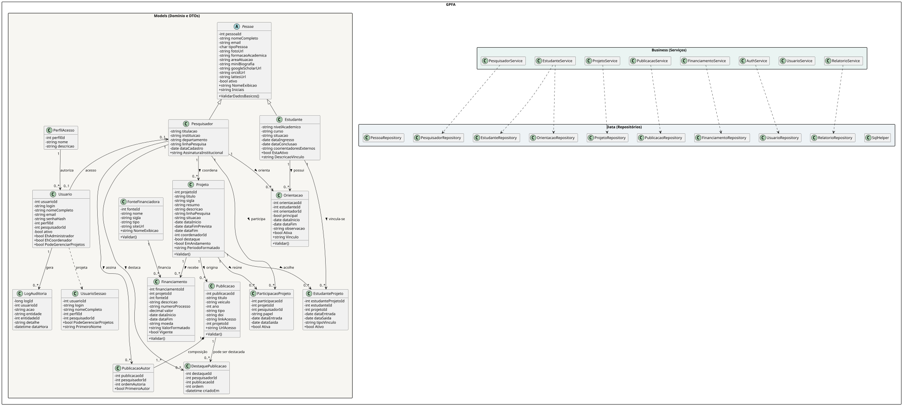

# 07 — Modelagem orientada a objetos e diagrama de classes

## 1. Diagrama



- Fonte editável PlantUML: [`diagrams/classes.puml`](diagrams/classes.puml)
- Fonte editável Mermaid: [`diagrams/classes.mmd`](diagrams/classes.mmd)
- Exportações: `images/classes-uml.svg`, `images/classes-uml.png`, `images/classes-mermaid.svg`.

## 2. Estratégia de modelagem

O domínio foi modelado com **herança para pessoas** e **associações explícitas para todos os relacionamentos N:N**. Não há listas separadas por vírgula nem campos “mágicos”.

```text
Pessoa (abstrata)
├── Pesquisador  (1:1 com Pessoa — TPT)
└── Estudante    (1:1 com Pessoa — TPT)
```

### Por que herança?

Pesquisador e Estudante compartilham nome, e-mail, foto, formação, biografia e links, mas possuem atributos e ciclos de vida distintos. A herança evita duplicação e permite tratar ambos como `Pessoa` em operações comuns (por exemplo, avatar e dados de contato), mantendo regras específicas nas subclasses.

### Por que TPT (table-per-type) no banco?

- `Pessoa` guarda os dados comuns.
- `Pesquisador` e `Estudante` guardam apenas seus atributos.
- As FKs `PesquisadorId`/`EstudanteId` são também PKs, garantindo 1:1.
- Triggers verificam a coerência entre `Pessoa.TipoPessoa` e a tabela especializada.

Alternativas descartadas:

| Alternativa | Problema |
|---|---|
| Uma única tabela com todos os campos | Muitos nulos e regras frágeis |
| Tabelas independentes sem Pessoa | Duplicação de dados e e-mails |
| Herança apenas no código, sem TPT | Perda de integridade relacional |

## 3. Classes de domínio

### Pessoa (abstrata)

**Responsabilidade:** representar qualquer pessoa do portal e concentrar dados de identidade e divulgação.

**Atributos principais:** `PessoaId`, `NomeCompleto`, `Email`, `TipoPessoa`, `FotoUrl`, `FormacaoAcademica`, `AreaAtuacao`, `MiniBiografia`, `GoogleScholarUrl`, `OrcidUrl`, `LattesUrl`, `Ativo`.

**Comportamentos:** `NomeExibicao`, `Iniciais`, `PossuiLinksExternos`, `ValidarDadosBasicos()`.

### Pesquisador

**Responsabilidade:** representar docentes/pesquisadores com titulação, instituição, departamento e linha de pesquisa.

**Atributos:** `Titulacao`, `Instituicao`, `Departamento`, `LinhaPesquisa`, `DataCadastro`.

**Comportamentos:** `AssinaturaInstitucional` (composição textual para exibição).

**Associações:** coordena projetos, participa de projetos, orienta estudantes, assina publicações, mantém destaques e pode possuir usuário.

### Estudante

**Responsabilidade:** representar alunos de graduação/pós, com nível, curso, situação, ingresso, conclusão e coorientadores externos.

**Comportamentos:** `EstaAtivo`, `DescricaoVinculo`.

**Associações:** possui orientações e vínculos com projetos.

### Projeto

**Responsabilidade:** agregar a pesquisa, sua coordenação única, participantes, estudantes, publicações e financiamentos.

**Atributos:** título, sigla, resumo, descrição, linha, situação, datas, `CoordenadorId`, imagem e destaque.

**Comportamentos:** `EmAndamento`, `Concluido`, `PeriodoFormatado`, `Validar()`.

**Decisão:** o coordenador é uma associação 1:1 obrigatória (`CoordenadorId`), não uma lista.

### Orientacao

**Responsabilidade:** registrar o histórico de orientação, incluindo principal e coorientações internas.

**Atributos:** estudante, orientador, `Principal`, datas, observação.

**Regras:** uma principal ativa por estudante; externos ficam em texto no estudante.

### ParticipacaoProjeto

**Responsabilidade:** associar pesquisadores (exceto o coordenador) a projetos, com papel e período.

### EstudanteProjeto

**Responsabilidade:** associar estudantes a projetos, com tipo de vínculo e período.

### Publicacao / PublicacaoAutor

**Responsabilidade:** registrar a publicação e a autoria ordenada. `PublicacaoAutor` é a tabela associativa N:N.

### DestaquePublicacao

**Responsabilidade:** associar até cinco publicações a um pesquisador, com posição 1–5.

### FonteFinanciadora / Financiamento

**Responsabilidade:** representar a fonte e o registro de verba por projeto, com valor positivo e período.

### Usuario / PerfilAcesso

**Responsabilidade:** autenticação, autorização e vínculo opcional a um pesquisador. `UsuarioSessao` é um DTO imutável usado na Session (sem hash).

### LogAuditoria

**Responsabilidade:** registrar ações administrativas e de autenticação.

## 4. Relacionamentos e multiplicidades

| Relacionamento | Multiplicidade | Implementação |
|---|---|---|
| Pessoa–Pesquisador | 1:0..1 | TPT (`PesquisadorId` PK/FK) |
| Pessoa–Estudante | 1:0..1 | TPT (`EstudanteId` PK/FK) |
| Pesquisador–Projeto (coordenação) | 1:0..* | `Projeto.CoordenadorId` |
| Pesquisador–ParticipacaoProjeto | 1:0..* | FK |
| Projeto–ParticipacaoProjeto | 1:0..* | FK + UNIQUE |
| Estudante–Orientacao | 1:0..* | FK + índice de principal ativa |
| Pesquisador–Orientacao | 1:0..* | FK |
| Estudante–EstudanteProjeto | 1:0..* | FK + UNIQUE |
| Projeto–EstudanteProjeto | 1:0..* | FK |
| Publicacao–PublicacaoAutor | 1:1..* | composição; cascade |
| Pesquisador–PublicacaoAutor | 1:0..* | FK |
| Pesquisador–DestaquePublicacao | 1:0..5 | CHECK + trigger |
| Projeto–Financiamento | 1:0..* | FK |
| Fonte–Financiamento | 1:0..* | FK |
| Usuario–PerfilAcesso | 0..*:1 | FK |
| Usuario–LogAuditoria | 1:0..* | FK `SET NULL` |

### Associação, agregação e composição

- **Associação:** pesquisador participa de projeto; estudante possui orientação.
- **Agregação:** projeto reúne participantes e estudantes — eles existem independentemente do projeto.
- **Composição:** `PublicacaoAutor` e `DestaquePublicacao` dependem da publicação; ao excluí-la, são removidos por cascata. `Publicacao` não existe sem autor (regra de negócio).

## 5. Serviços e repositórios

O diagrama inclui a camada de serviços para mostrar responsabilidades, mas ela **não é entidade de domínio**:

- `PesquisadorService`, `EstudanteService`, `ProjetoService`, `PublicacaoService`, `FinanciamentoService`, `AuthService`, `UsuarioService`, `RelatorioService`.
- Repositórios encapsulam SQL e transações.
- `AppServices` compõe as dependências.

Isso mantém as entidades coesas e evita “modelos anêmicos”: as entidades validam seus próprios dados e expõem comportamentos; os serviços coordenam casos de uso e transações.

## 6. Decisões de projeto orientado a objetos

| Decisão | Justificativa |
|---|---|
| Herança apenas para Pessoa | Evita hierarquias artificiais; as demais relações são associações |
| Coordenador como FK no Projeto | Garante cardinalidade 1:1 no banco |
| Orientações como histórico, não campo | Permite egressos e troca de orientador |
| Coorientadores externos como texto | Não exige cadastro de pessoas externas |
| Destaques em tabela própria | Permite ordem, limite e auditoria |
| Financiamento por projeto, não por pessoa | Recurso pertence ao projeto; evita duplicação |
| DTOs para leitura | Views e relatórios não precisam carregar o grafo completo |
| Exceções de domínio | `ValidacaoException` e `IntegridadeDadosException` comunicam regras sem vazar SQL |

## 7. Coesão e acoplamento

- Entidades não conhecem banco, HTTP ou HTML.
- Serviços dependem de repositórios, não de `SqlConnection`.
- Repositórios não validam regras de apresentação.
- A apresentação depende de serviços, nunca de repositórios.
- DTOs reduzem o acoplamento entre views e modelo.

## 8. Rastreabilidade com o banco

Cada classe persistente possui tabela correspondente. As classes de associação (`ParticipacaoProjeto`, `EstudanteProjeto`, `PublicacaoAutor`, `DestaquePublicacao`) são tabelas explícitas — nenhum relacionamento N:N foi implementado com campos de texto ou listas separadas por vírgula.

O modelo lógico completo está em [`09-modelagem-DER.md`](09-modelagem-DER.md).
