# 08 — Modelagem conceitual (MER)

## 1. Diagrama

- Fonte editável Mermaid: [`diagrams/mer.mmd`](diagrams/mer.mmd)
- Exportações: `images/mer.svg`, `images/mer.png`.

## 2. Entidades

| Entidade | Descrição | Identificador |
|---|---|---|
| **PerfilAcesso** | Perfil de autorização | PerfilId |
| **Pessoa** | Dados comuns de qualquer pessoa | PessoaId |
| **Pesquisador** | Especialização de Pessoa | PesquisadorId (= PessoaId) |
| **Estudante** | Especialização de Pessoa | EstudanteId (= PessoaId) |
| **Projeto** | Projeto científico | ProjetoId |
| **ParticipacaoProjeto** | Associação pesquisador–projeto | ParticipacaoId |
| **EstudanteProjeto** | Associação estudante–projeto | EstudanteProjetoId |
| **Orientacao** | Histórico de orientação | OrientacaoId |
| **Publicacao** | Produção científica | PublicacaoId |
| **PublicacaoAutor** | Associação publicação–pesquisador | (PublicacaoId, PesquisadorId) |
| **DestaquePublicacao** | Destaques de um pesquisador | DestaqueId |
| **FonteFinanciadora** | Agência/fundação/parceria | FonteId |
| **Financiamento** | Verba de um projeto em uma fonte | FinanciamentoId |
| **Usuario** | Conta de acesso | UsuarioId |
| **LogAuditoria** | Registro de ações | LogId |

## 3. Relacionamentos e cardinalidades

| Relacionamento | Cardinalidade | Regra |
|---|---|---|
| Pessoa–Pesquisador | 1 : 0..1 | Uma pessoa pode ser pesquisador; um pesquisador é uma pessoa |
| Pessoa–Estudante | 1 : 0..1 | Uma pessoa pode ser estudante; um estudante é uma pessoa |
| Pesquisador–Projeto (coordena) | 1 : 0..* | Um pesquisador coordena vários projetos; **cada projeto tem exatamente 1 coordenador** |
| Pesquisador–ParticipacaoProjeto | 1 : 0..* | Um pesquisador pode participar de vários projetos |
| Projeto–ParticipacaoProjeto | 1 : 0..* | Um projeto tem vários participantes (além do coordenador) |
| Estudante–Orientacao | 1 : 0..* | Um estudante tem histórico de orientações |
| Pesquisador–Orientacao | 1 : 0..* | Um pesquisador orienta vários estudantes |
| Estudante–EstudanteProjeto | 1 : 1..* (ativo: 1..*) | Estudante ativo deve ter ≥1 projeto |
| Projeto–EstudanteProjeto | 1 : 0..* | Projeto recebe vários estudantes |
| Publicacao–PublicacaoAutor | 1 : 1..* | Publicação tem ≥1 autor |
| Pesquisador–PublicacaoAutor | 1 : 0..* | Pesquisador assina várias publicações |
| Pesquisador–DestaquePublicacao | 1 : 0..5 | Até 5 destaques por pesquisador |
| Publicacao–DestaquePublicacao | 1 : 0..* | Uma publicação pode ser destacada por vários autores |
| Fonte–Financiamento | 1 : 0..* | Uma fonte financia vários registros |
| Projeto–Financiamento | 1 : 0..* | Um projeto pode ter vários financiamentos |
| PerfilAcesso–Usuario | 1 : 0..* | Um perfil autoriza vários usuários |
| Usuario–LogAuditoria | 1 : 0..* | Um usuário gera vários logs |

## 4. Entidades associativas

Nenhum N:N foi implementado como campo texto.

| Associação | Chave | Atributos próprios |
|---|---|---|
| **ParticipacaoProjeto** | ParticipacaoId; UNIQUE(ProjetoId, PesquisadorId) | Papel, DataEntrada, DataSaida |
| **EstudanteProjeto** | EstudanteProjetoId; UNIQUE(EstudanteId, ProjetoId) | DataEntrada, DataSaida, TipoVinculo |
| **PublicacaoAutor** | PK composta (PublicacaoId, PesquisadorId) | OrdemAutoria |
| **DestaquePublicacao** | DestaqueId; UNIQUE(PesquisadorId, PublicacaoId), UNIQUE(PesquisadorId, Ordem) | Ordem, CriadoEm |

## 5. Restrições de negócio representadas no MER

1. **Coordenação única:** o relacionamento “coordena” é 1:1 do lado do projeto. Não existe entidade associativa de coordenação.
2. **Orientador principal único e ativo:** representado por `Orientacao.Principal` + parcialidade de `DataFim`; no físico, índice único filtrado.
3. **Estudante ativo com projeto:** cardinalidade mínima 1, garantida por aplicação + trigger.
4. **Até 5 destaques:** cardinalidade máxima 5, garantida por CHECK + trigger.
5. **Valor positivo:** atributo derivado/restrito `Valor > 0`.
6. **Publicação com autor:** cardinalidade mínima 1.
7. **Exclusão protegida:** relacionamentos sem cascata quando há histórico acadêmico/financeiro.

## 6. Atributos derivados

| Atributo | Cálculo | Uso |
|---|---|---|
| Total captado por projeto | `SUM(Financiamento.Valor)` | Página de projeto, relatórios |
| Total por fonte | `SUM` agrupado por fonte | Relatório |
| Total por pesquisador | Soma dos projetos distintos em que coordena/participa | Perfil e relatório |
| Qtd. orientandos atuais | Orientações sem `DataFim` + estudante ativo | Perfil/relatório |
| Qtd. orientandos passados | Orientações encerradas ou estudante não ativo | Perfil/relatório |
| Qtd. publicações | Contagem em `PublicacaoAutor` | Perfil |
| Situação do vínculo | Derivada de `DataFim`/situação do estudante | View |

## 7. Decisões conceituais

- **Pessoa como superclasse:** evita repetição e permite evolução para novos tipos (ex.: técnico administrativo).
- **Coordenador como associação, não atributo textual:** integridade e relatórios.
- **Orientações como histórico:** atende RN02 sem perder dados.
- **Coorientadores externos em texto:** a carta permite; não se cria pessoa fictícia.
- **Destaques como relação:** permite ordem e limite.
- **Financiamento ligado ao projeto:** o recurso é do projeto, não de uma pessoa; o total por pesquisador é uma visão derivada.
- **Usuário separado de pesquisador:** nem todo usuário é pesquisador (admin), e nem todo pesquisador tem login.

## 8. Escopo do modelo

O MER cobre todos os requisitos funcionais. Não há entidades para:
- arquivos binários de imagem (apenas URL);
- e-mails enviados;
- logs de acesso HTTP;
- integrações externas.

Essas decisões estão justificadas em [`15-historico-decisoes.md`](15-historico-decisoes.md).
