# 11 — Arquitetura de software

## 1. Visão geral



O sistema segue uma arquitetura em camadas com dependências apontando para o domínio:

```text
GPFA.Portal  →  GPFA.Business  →  GPFA.Data  →  GPFA.Models
      │                │               │
      └── chama serviços, nunca SQL ──┘
```

| Camada | Projeto | Responsabilidades | Não faz |
|---|---|---|---|
| Apresentação | `GPFA.Portal` | Páginas ASPX, Master Pages, controles, Data Binding, validação de formulário, navegação, layout | SQL, regras de negócio complexas |
| Negócio | `GPFA.Business` | Casos de uso, validações, autorização de escopo, cálculos, transações coordenadas | HTML, Session, SQL direto |
| Dados | `GPFA.Data` | Repositórios, ADO.NET, comandos parametrizados, mapeamento, tradução de erros SQL | Regras de apresentação |
| Modelos | `GPFA.Models` | Entidades, DTOs, exceções de domínio, constantes | Dependências de infraestrutura |
| Testes | `GPFA.Tests` | Testes de integração contra o schema real | UI automatizada |

## 2. Estrutura de pastas

```text
src/GPFA.Portal/
├── Site.Master                 # layout público
├── Admin/Admin.Master          # Master aninhada do painel
├── BasePage.cs                 # sessão, autorização, flash, CSRF
├── Admin/AdminPageBase.cs      # proteção do painel
├── Default.aspx                # home
├── Pesquisadores.aspx
├── Pesquisador.aspx
├── Estudantes.aspx
├── Projetos.aspx
├── Projeto.aspx
├── Publicacoes.aspx
├── Sobre.aspx
├── Login.aspx
├── AlterarSenha.aspx
├── Erro.aspx / AcessoNegado.aspx
├── Admin/*.aspx                # 12 páginas administrativas
├── Content/css/site.css        # design system
├── Content/vendor              # Bootstrap local
└── Web.config                  # conexão, auth, headers

src/GPFA.Business/
├── AppServices.cs              # composição
├── AuthService.cs
├── PesquisadorService.cs
├── EstudanteService.cs
├── ProjetoService.cs
├── PublicacaoService.cs
├── FinanciamentoService.cs
├── UsuarioService.cs
├── RelatorioService.cs
├── Validacao.cs
└── Security/PasswordHasher.cs

src/GPFA.Data/
├── Database.cs
├── SqlHelper.cs
├── SqlErrorTranslator.cs
├── Mappers.cs
└── *Repository.cs

src/GPFA.Models/
├── Dominio.cs
├── Pessoa.cs
├── Projeto.cs
├── Orientacao.cs
├── Publicacao.cs
├── Financiamento.cs
├── Usuario.cs
└── DTOs.cs
```

## 3. Fluxo de uma requisição

Exemplo: salvar um projeto.

1. O navegador envia POST com ViewState e EventValidation.
2. ASP.NET valida o ViewState (`ViewStateUserKey`).
3. `AdminPageBase.OnLoad` verifica autenticação.
4. `Page_Load` só carrega dados se `!IsPostBack`; o evento do botão é executado.
5. A página valida controles (`Page.Validate`) e monta o modelo.
6. `ProjetoService.Salvar` valida regras, escopo do usuário e datas.
7. `ProjetoRepository` executa SQL parametrizado em transação.
8. Erros SQL são traduzidos para `IntegridadeDadosException`.
9. A página grava mensagem flash em Session e redireciona (PRG).
10. A próxima requisição lê o flash e o renderiza.

## 4. Web Forms: ciclo de vida

| Evento | Uso no projeto |
|---|---|
| `Page_Init` | `BasePage` define `ViewStateUserKey`; dashboard registra diagnóstico |
| `Page_Load` | `IsPostBack` evita recarregar dados; carrega listas e combos |
| Eventos de controles | `btnSalvar_Click`, `RowCommand`, `SelectedIndexChanged` |
| `Page_PreRender` | Dashboard atualiza diagnóstico; Master lê flash; labels finais |
| `Render` | Controles geram HTML; Data Binding já resolvido |

### `IsPostBack`

Todos os `Page_Load` carregam dados somente na primeira requisição. Em postbacks, os controles são restaurados do ViewState e os dados são recarregados apenas quando uma ação exige (filtro, edição, salvamento).

### Data Binding

- **Repeater** nas páginas públicas (cards, publicações, listas).
- **GridView** no painel (pesquisadores, estudantes, projetos, financiamentos, usuários, auditoria).
- **DropDownList / CheckBoxList** para combos e seleção múltipla.
- **Literal** para valores já codificados.
- `Eval`/`Bind` com helpers de formatação e `AvatarHtml`.

### ViewState

- Mantém o estado dos controles e filtros entre postbacks.
- `ViewStateUserKey` vincula o ViewState à sessão (mitigação de CSRF).
- O contador de diagnóstico é um exemplo didático de estado por página.

### Session

Usada para:

| Chave | Conteúdo | Motivo |
|---|---|---|
| `GPFA.UsuarioAtual` | DTO `UsuarioSessao` | Evitar consultar o usuário a cada postback |
| `GPFA.Flash` | mensagem de sucesso/erro | Padrão Post/Redirect/Get |
| `GPFA.Lifecycle` | últimos eventos do ciclo | Demonstração da rubrica |

Session **não** substitui o banco: listas, cadastros e relatórios são sempre consultados no SQL Server. Timeout de 60 minutos.

## 5. Master Pages

- `Site.Master`: cabeçalho, menu público, flash, conteúdo e rodapé.
- `Admin/Admin.Master`: **Master aninhada** (`MasterPageFile="~/Site.Master"`) que adiciona sidebar, topbar e área de conteúdo administrativo.
- O menu administrativo é montado conforme o perfil (`PlaceHolder` visível/invisível).

## 6. Segurança

| Controle | Implementação |
|---|---|
| Autenticação | Forms Authentication + Session |
| Senhas | PBKDF2-HMAC-SHA256, 120k iterações, salt 16 bytes, hash 32 bytes |
| Bloqueio | 5 falhas → 15 minutos |
| Autorização | `AdminPageBase`, `ExigirPerfis`, serviços com escopo de projeto |
| CSRF | `ViewStateUserKey`, `SameSite=Lax`, MAC de ViewState |
| SQL Injection | 100% consultas parametrizadas |
| XSS | `HttpUtility.HtmlEncode` em literais e helpers; `UrlAttr` valida/encoda URLs |
| Open redirect | `ReturnUrlSeguro` aceita apenas caminhos locais |
| Headers | `X-Content-Type-Options`, `X-Frame-Options`, `Referrer-Policy`, `Permissions-Policy` |
| Erros | log interno, mensagem genérica ao usuário, sem stack trace |
| Auditoria | `LogAuditoria` para ações administrativas e login |

## 7. Tratamento de erros

```text
SqlException
   ├── 547 (FK)        → "registro relacionado a outros dados"
   ├── 2601/2627 (UQ)  → "dados únicos já existentes"
   ├── 50020–50050     → mensagem do trigger (regra de negócio)
   └── outros          → mensagem genérica + log
ValidacaoException     → erros de formulário
RegraNegocioException  → permissão/escopo
```

`Global.Application_Error` grava em `App_Data/logs/erros-AAAA-MM-DD.log` e redireciona para `Erro.aspx`. `ThreadAbortException` de redirecionamentos é ignorada.

## 8. Composição e dependências

`AppServices.Initialize(connectionString)` cria repositórios e serviços uma única vez. Repositórios são stateless e abrem conexões por operação, portanto podem ser compartilhados entre requisições com segurança.

Não há container DI externo para manter o projeto simples e compatível com o escopo acadêmico. A injeção é feita por construtor nos serviços, o que permite testes.

## 9. Banco e transações

- `SqlHelper.InTransaction` agrupa operações críticas:
  - criar estudante + orientação + vínculos;
  - criar/atualizar publicação + autores;
  - trocar orientador principal;
  - excluir estudante com histórico;
  - atualizar pessoa + especialização.
- `SqlHelper` centraliza timeout, parâmetros e tradução de erros.
- Views concentram cálculos de relatório e evitam duplicação.

## 10. Desempenho

- Índices em FKs e colunas de filtro.
- `vw_*` com subconsultas independentes para evitar produtos cartesianos.
- Paginação nas listas administrativas e na página pública de publicações.
- Carregamento de dados somente quando necessário (`!IsPostBack`).
- Assets locais e cacheáveis (fontes, Bootstrap, CSS).

## 11. Compatibilidade e execução

- .NET Framework 4.8.1, C# 7.3.
- Visual Studio 2026 / MSBuild 18.
- IIS Express para desenvolvimento.
- SQL Server LocalDB.
- Sem dependências de CDN em tempo de execução.

## 12. Limitações arquiteturais conhecidas

1. **Session InProc**: reiniciar o pool perde a sessão; o usuário é redirecionado ao login.
2. **Sem upload de arquivos**: imagens são referenciadas por URL/caminho.
3. **Sem testes de UI automatizados**: a suíte cobre negócio, dados e banco; o fluxo Web Forms foi validado manualmente e por smoke tests HTTP.
4. **Relatórios em tela/impressão**: não há exportação PDF/Excel nativa.
5. **Um perfil por usuário**: não há múltiplos papéis simultâneos.

Essas limitações são conscientes e estão registradas no histórico de decisões.
